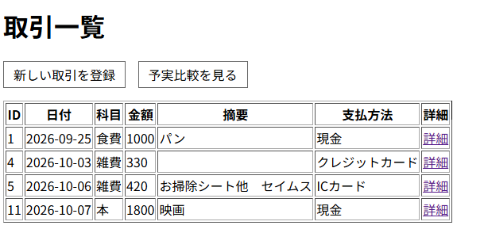
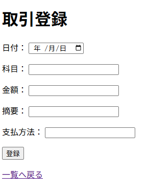
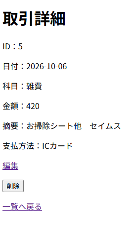
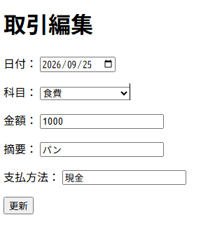
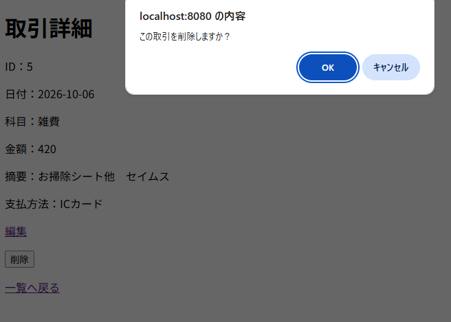
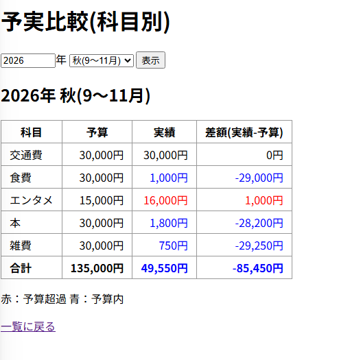
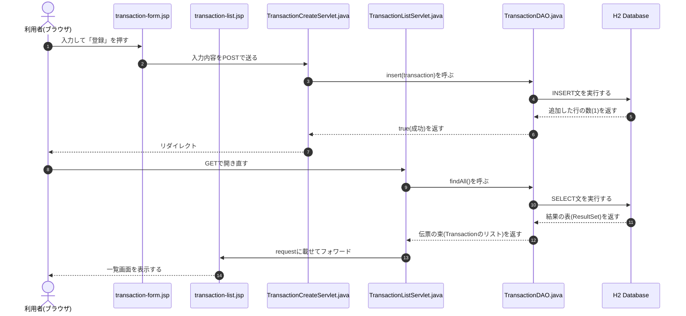
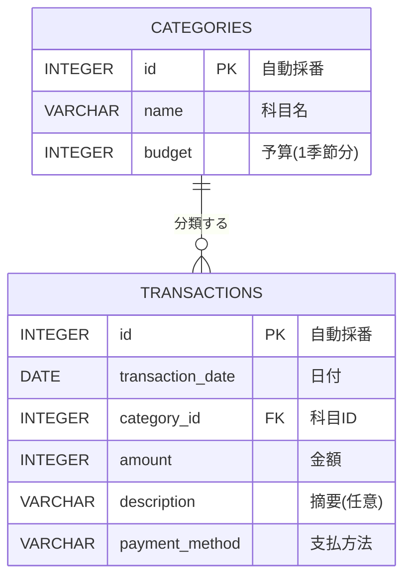

# HouseholdBudget（家計・予実管理アプリ）

## 概要・目的
家計簿Webアプリ

未経験からJava開発の理解を深めることを目的に制作しました。
経理の経験から、あったらいいなという機能を備えたシンプルなアプリがストアでは見つけられず、自分で作ろうと思いました。


## 主な機能
- 取引の一覧表示・登録・詳細表示・編集・削除(削除前確認ダイアログあり)。
- 入力チェック機能(入力必須・文字数制限・金額の範囲制限)。エラーで戻ってもさっきまでの入力値は残ったまま。
- 予実比較(季節ごとに、科目別の予算と実績を比較。予算超過は赤、予算内は青で表示)


## 今後実現したい機能
- アラート機能。このままのペースでは予算を超過、もしくは大きく過少になってしまう場合に前もって知らせてくれる。
- カロリー管理機能。登録時に食費科目が使われるとき自動的にカロリーを計算。平均的な総消費カロリーを超えそうな場合に、それを相殺するのに必要な運動量を表示してくれる。


## 画面

### 一覧画面
登録した取引を一覧で表示します。「詳細」から各取引の詳細画面に、「予実比較を見る」から予実比較画面に移動できます。


### 登録画面
取引を登録します。


### 詳細画面
取引の詳細を表示します。


### 編集画面
取引内容の編集ができます。内容を変更してから「更新」を押すと変更が反映され、詳細画面に戻ります。


### 削除前の確認
OKを押すと削除できます。確認画面をはさむことで、間違って削除してしまうことを防ぎます。


### 予実比較画面
年と季節(春・夏・秋・冬)を選ぶと、科目ごとの予算・実績とその差額を表示します。予算を超えた科目は赤、予算内の科目は青で表示されます。



## 使用技術
- Java
- Servlet / JSP / JSTL
- JDBC / SQL(H2 Database)
- Apache Tomcat 11
- Eclipse
- Git / GitHub


## 構成
- Model
	- Transaction：取引のID、日付、科目ID、科目名、金額、摘要、支払方法を保持します。
	- Category：科目ID、科目名を保持します。
	- BudgetSummary：予実比較の1行分(科目名、予算、実績)を保持し、差額や予算超過かどうかを計算します。
- View
	- JSP：一覧・登録・詳細・編集・予実比較画面を担当します。
- Controller
	- Servlet：リクエストを受け取り、DAOの呼び出しや画面遷移を担当します。
- DAO
	- TransactionDAO：JDBCを利用してH2 DatabaseへのSELECT / INSERT / UPDATE / DELETEを担当します。
	- CategoryDAO：JDBCを利用してH2 Databaseへの科目の一覧の取得を担当します。
	- BudgetSummaryDAO：指定した期間の、科目ごとの予算と実績の集計を担当します。
- Validator
	- TransactionValidator：登録・編集の入力チェックを担当します。


## 処理の流れ(登録 → 一覧表示)


## テーブル設計(ER図)



## 起動方法

### 必要な環境
- Java 25
- Apache Tomcat 11
- H2 Database 2.4.240
- Eclipse

### テーブルの作成
```sql
-- ① 科目テーブル
CREATE TABLE categories (
	id INTEGER GENERATED BY DEFAULT AS IDENTITY PRIMARY KEY,
	name VARCHAR(10) NOT NULL UNIQUE,
	budget INTEGER DEFAULT 0 NOT NULL
);
```

```sql
-- ② 科目と予算の登録
INSERT INTO categories (name, budget) VALUES ('交通費', 30000);
INSERT INTO categories (name, budget) VALUES ('食費', 30000);
INSERT INTO categories (name, budget) VALUES ('エンタメ', 15000);
INSERT INTO categories (name, budget) VALUES ('本', 30000);
INSERT INTO categories (name, budget) VALUES ('雑費', 30000);
```

```sql
-- ③ 取引テーブル(categories を先に作る必要がある)
CREATE TABLE transactions (
	id INTEGER GENERATED BY DEFAULT AS IDENTITY PRIMARY KEY,
	transaction_date DATE NOT NULL,
	category_id INTEGER NOT NULL,
	amount INTEGER NOT NULL,
	description VARCHAR(255),
	payment_method VARCHAR(50) NOT NULL,
	FOREIGN KEY (category_id) REFERENCES categories(id)
);
```

### 起動手順
1. このリポジトリーをクローンし、Eclipseにインポートする
2. スタートメニューから「H2 Console」を起動する
3. タスクトレイのH2アイコンを右クリックし、「Create a new database...」で `~/householdbudget` を作る（ユーザー名 `sa`）
4. H2コンソールに接続し、上の「テーブルの作成」のSQLを実行する
   - JDBC URL：`jdbc:h2:tcp://localhost/~/householdbudget`
   - ユーザー名：`sa`、パスワード：なし
5. EclipseでプロジェクトをTomcat 11に追加して起動する
6. ブラウザで `http://localhost:8080/HouseholdBudget/TransactionListServlet` を開く


## 学習・工夫したこと

- 処理の説明などコメントで適宜残し、コードの理解を深められるようにした。
- MVCを意識してServletとJSPの役割を分けた。
- DAOを使用してデータベース処理を分離した。
- SQLの実行にはPreparedStatementを使い、SQLインジェクションを防いだ。
- 入力チェックの処理を`TransactionValidator`にまとめ、登録と編集で共通化した。
- 画面に出す値を`<c:out>`で出力し、XSS対策をした。
- 登録後にリダイレクトし、再読み込みでの二重登録を防いだ（PRGパターン）。
- 科目を別テーブルで管理し、取引には科目IDを保存した。外部キーで、存在しない科目IDが登録されないようにした。
- 予実比較では取引が0件の科目も表に残るようにLEFT JOINを使い、期間の条件をWHEREではなくONに書いた。合計がないときはCOALESCEで0にした。
- 季節から期間を求める計算はJavaの`LocalDate`で行った。開始日に3か月を足して終了日にすることで、冬の年またぎや2月末を自分で計算しなくて済むようにした。
- 年や季節はURLで書き換えられるため、サーバー側で値の範囲をチェックした。


## 開発中に発生した問題と解決

### GitHubへのプッシュが拒否された
EclipseからGitHubへプッシュした際、「git-receive-pack not permitted」というエラーが出た。GitHubのアクセストークンの使えるリポジトリーが限定されていて、新しく作ったHouseholdBudgetが含まれていなかった。
エラーメッセージから原因を絞り込み、トークンの設定画面で、対象のリポジトリーにHouseholdBudgetを追加した。トークンは、使う範囲を限定して作ると安全であることも学んだ。

### コードの記載漏れやタイプミスにより画面が表示されなかった
${pageContext.request.contextPath}の`contextPath`の`P`が小文字のままだったり、入力間違いが起こってしまった。エラーメッセージから間違いの行を確認して訂正したり、AIにスクリーンショットを送って問題解決にあたった。

### JSPで `//` のコメントを使い、画面に文字が表示されてしまった
Javaのコメントの使い方で、JSPのHTMLの部分ではただの文字として扱われる。`<%-- --%>` に修正した。

### 漢字の多い画面を、Chromeが中国語と判定して自動翻訳してしまった
ページに言語の指定がなかったため、Chromeが文字の見た目から言語を推測していた。日本語と認識されるように、`<html lang="ja"> `を指定した。

### SQL(Javaから見ると""で囲んだただの文字列)やEL(存在しない名前を書くと空として扱われる)の打ち間違いはエラーにならない
`transaction`(末尾のsが抜けている)と書いても、Eclipseは教えてくれない。コードは慎重に入力すること、変更するたびに動作確認すること、似た処理と見比べることが大事だと学んだ。


## AIの活用

開発ではChatGPT、Claudeを開発、学習、デバッグ支援として利用しました。

AIが出力するコードをそのままコピー&ペーストして利用するのではなく、必要な機能を指示しつつ、コーディング部分を小さな単位に分けて出力してもらい、コードの役割を確認しながら実装しました。エラーが発生した際には、原因を確認して修正する流れも学習しました。